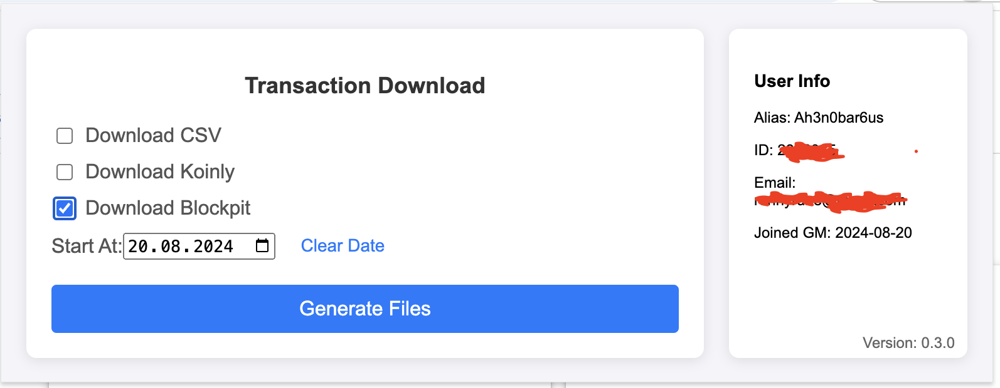
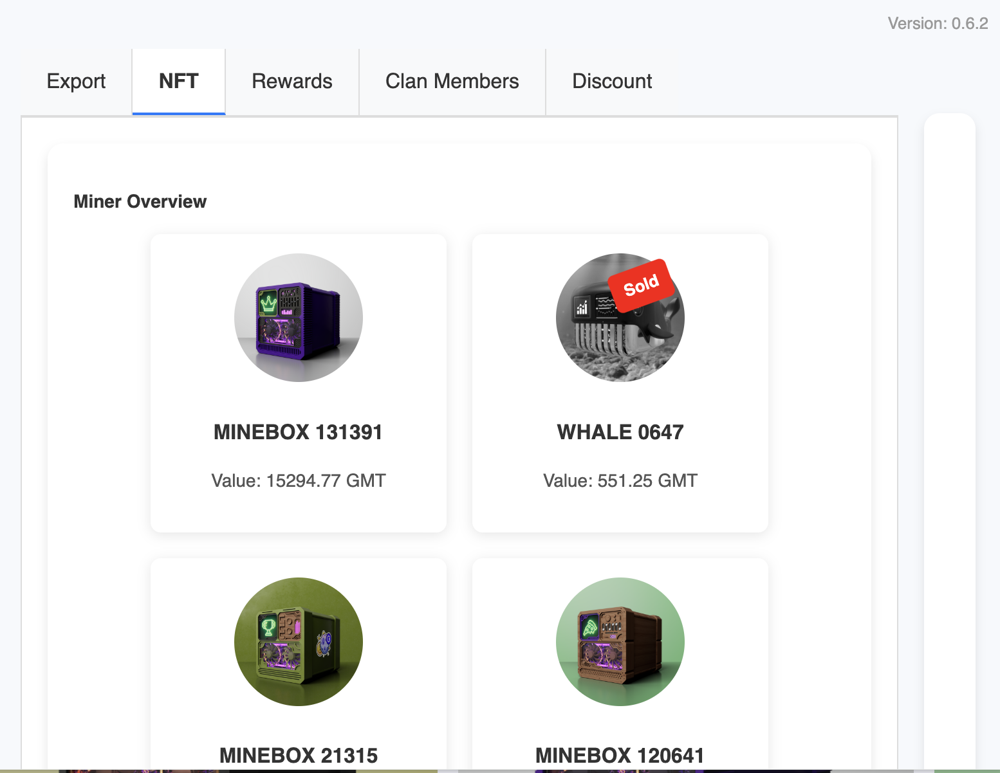

# Chrome Extension: GoMining Overview

Diese Chrome Extension liest automatisch das GoMining `access_token` aus Cookies aus und zeigt dir im Popup eine Übersicht über deinen Account (NFTs/Miner, Rewards, Clan, Discounts, Marketplace).

[](https://github.com/Ah3n0/gm-transaction-overview)
[](https://github.com/Ah3n0/gm-transaction-overview/actions/workflows/test.yml)





---

## Installation

### Step 1: Download the Repository
1. Visit the [GitHub repository page](#).
2. Click the green **Code** button and select **Download ZIP**.
3. Extract the ZIP file to a folder on your computer.

### Step 2: Install the Extension in Chrome
1. Open Google Chrome and go to `chrome://extensions`.
2. Enable **Developer Mode** by toggling the switch in the top-right corner.
3. Click **Load unpacked**.
4. Navigate to the folder where you extracted the repository and click **Select Folder**.
5. The extension will now appear in your list of installed extensions.

### Step 3: Using the Extension
1. **Pin the Extension** (optional but recommended):
   - Click the puzzle piece icon in Chrome's toolbar (top-right corner).
   - Find the newly installed extension in the list and click the pin icon to keep it visible.
2. **Open the Extension** by clicking its icon in the toolbar.
3. **Follow the On-Screen Instructions**:
   - Ensure you are logged into GoMining (no credentials are required by the extension).
4. **Tabs nutzen** (oben im Popup):
   - NFT: Miner Übersicht + Events
   - Rewards: persönliche Rewards
   - Clan Members: Mitglieder inkl. Sort/Filter + Totals
   - Discount: Discount + Maintenance Info
   - Marketplace: 10 günstigste Miner nach $/TH
5. **Enjoy the Features** offered by the extension!

---

## Features

1. **Login Status Check**: Confirms if the user is logged into GoMining.
2. **NFT Overview**: List all belonging NFTs and their upgrades.
3. **Rewards**: Personal rewards overview.
4. **Clan Members**: Member list with sorting/filtering and computed totals.
5. **Discount & Maintenance**: Current discount and maintenance information + service button.
6. **Marketplace**: Shows the 10 currently cheapest miners by $/TH.

---

## Contributing

We welcome contributions to improve this project. To get started:
1. Fork the repository on GitHub.
2. Create a new branch for your feature or bug fix.
3. Make your changes and commit them with descriptive messages.
4. Push your branch to your fork.
5. Submit a Pull Request (PR) to merge your changes into the original repository.

---

## Roadmap

Here are some planned features and improvements for future updates:
1. **Background Processing**: Allow long-running operations to continue even when the popup is closed.
2. **Wallet Integration**: Add BTC wallet support and enable wallet selection.
3. **Buy/Sell Data**: Include additional account data where useful.
4. Show Clan joiner and leaver.

---

## Support the Project

If you enjoy using this extension and would like to support its development, consider the following options:

1. **Refer Friends to GoMining**: Use this [GM referral link](https://gomining.com/?ref=Zi-68) - Code Zi-68.
2. **Donate BTC on BNB Chain**:
   Send BTC to the following address:
   ```bash
   1LB619xV9vwGJVu7L5e9qdLZvGZhoYERvo
   ```

   Send USDT/TON (on TON Chain) to the following address:
   ```bash
   UQBz2QfwDidnl98mQdNrt7AVQD2V9QD7UiDGi-pENqC3qowk
   ```

   Send USDT (on TRC-20 Chain) to the following address:
   ```bash
   TP9mjWpNdoMRAnoLvVdJwM3yKuUgW7SzBi
   ```

Your support is greatly appreciated!

---

## License

This project is licensed under the [MIT License](LICENSE). Feel free to use, modify, and share it, but please credit the original authors.

---

**Thank you for using this project!** If you have any questions or suggestions, feel free to open an issue on GitHub.
